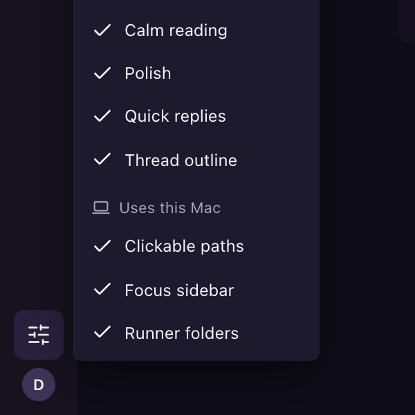
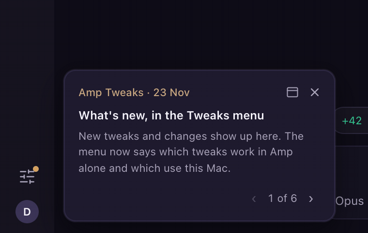
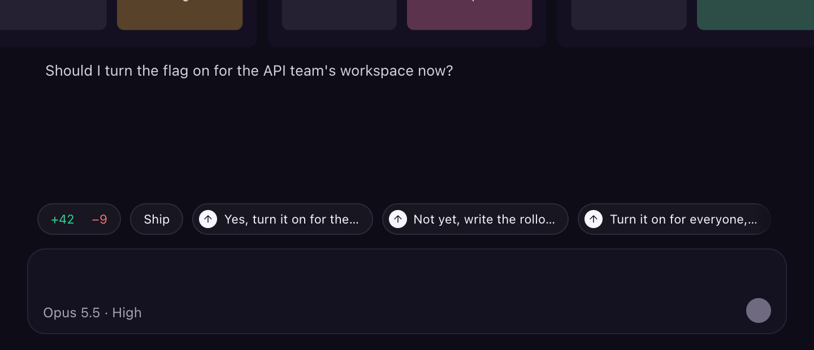
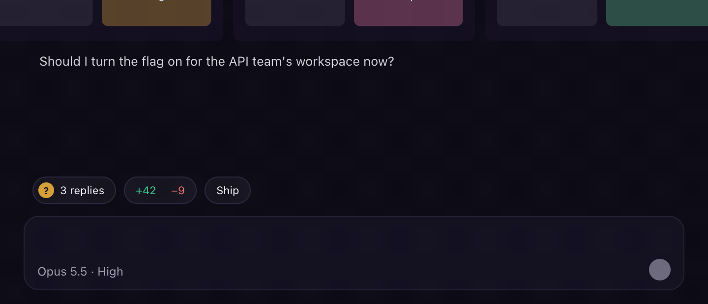
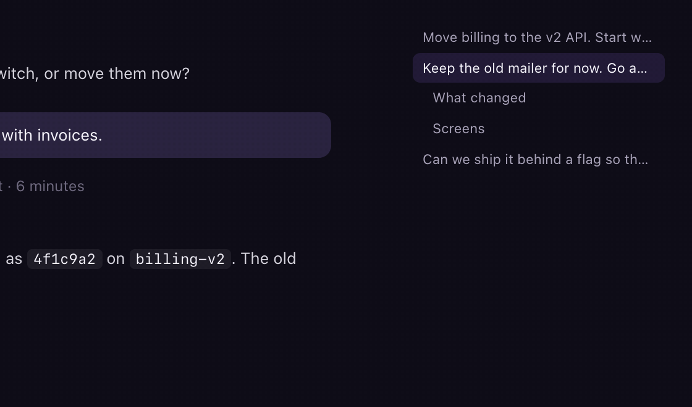
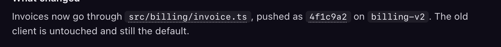
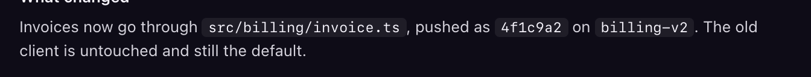
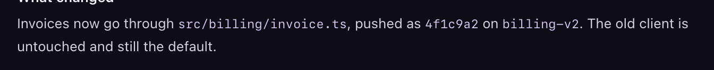
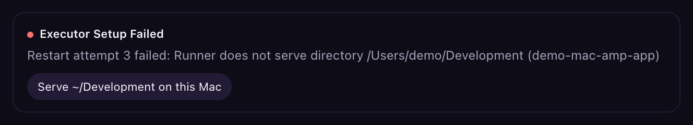

# amptweaks

Load your own CSS and JS into the Amp Mac app, the same way you'd use a userscript in a browser. It ships with a handful of tweaks, each in its own folder so you can turn them off one at a time.

This is an unofficial mod, it isn't made or supported by Amp.

## Install

```sh
curl -fsSL https://raw.githubusercontent.com/thesammykins/amptweaks/main/install.sh | zsh
```

Then quit and reopen Amp. Run the same line again to update.

It installs mitmproxy with Homebrew if you don't have it, and macOS will ask for your password once to trust a local certificate.

## Uninstall

```sh
curl -fsSL https://raw.githubusercontent.com/thesammykins/amptweaks/main/uninstall.sh | zsh
```

This puts your proxy settings back the way they were, removes the certificate and its trust, and deletes the logs and app. Your own tweaks in `~/.amp-tweaks` are left alone.

## How it works

Amp's Mac app is a native shell around ampcode.com, so tweaks go in at the network rather than by patching the app. A small proxy runs on your Mac and only ampcode.com is routed through it, everything else goes direct. It adds one script tag to Amp's pages, and that script loads the tweaks. The certificate it uses is restricted to ampcode.com, so it can't be used to intercept any other site. If the proxy stops, Amp connects directly and keeps working, just without tweaks.

## Bundled tweaks

Each one is its own folder, so you can switch them separately. Most work in Amp alone; a few use this Mac (the proxy or the `amp` CLI) and say so in the Tweaks menu. The screenshots come from demo pages with made-up threads.

### Tweaks menu (`tweak-settings`)

A button in Amp's left rail, above your profile, to turn each tweak on or off. A tweak with a script reloads Amp when you switch it; style-only ones switch in place. From the terminal, `amp-tweaks tweaks disable <name>` and `enable <name>` do the same: both write `~/.amp-tweaks/disabled`, so the app and the CLI always agree.

What's new in the menu shows each change as a card, like Amp's own news card, with a button to turn that tweak on. The icon in its header says whether it works in Amp alone or uses this Mac.

| Tweaks menu | What's new |
| --- | --- |
|  |  |

### Quick replies (`quick-replies`)

Amp's suggested replies fold into one chip. Hover or click it for the full list. When the agent is waiting on you, the chip shows a ? and the list starts with its question, which scrolls back to where it was asked. Picking a reply is a click on Amp's own reply button.

| Amp | Quick replies |
| --- | --- |
|  |  |

### Thread outline (`thread-outline`)

What you asked, down the right of long threads, with the headings of the section you're reading. Beside images it tucks into a rail on the right edge; hover the rail to bring it back. It shows only when the window is wide enough.



### Clickable paths (`clickable-paths`)

In threads that ran on a runner on this Mac, file paths Amp left as plain text open in Zed, VS Code or Cursor (whichever you have, or set `AMP_TWEAKS_EDITOR`), and commits open on GitHub. Amp's own file and commit links keep Amp's click; ⌥-click shows the file in Finder or opens the commit on GitHub. Orb threads and threads from other machines are left to Amp, which opens their files in its own tabs.



### Calm reading (`calm-reading`)

A little more space between lines, and inline code tinted instead of boxed.

| Amp | Calm reading |
| --- | --- |
|  |  |

### Polish (`polish`)

Small fixes across Amp. For now: links to other threads and artifacts in a reply, which Amp cuts short, show their full title on hover.

### Runner folders (`runner-folders`)

When Amp can't resume a thread because this Mac's runner doesn't serve its folder ("Runner does not serve directory …"), its message gets a button that serves that folder (`amp runner dirs add`). Only for runners on this Mac and folders under your home; `amp runner dirs remove` undoes it.



### Focus sidebar (`focus-sidebar`)

Swaps Amp's thread list for just the threads that need you and the ones still working. Screenshots: [tweaks/focus-sidebar](tweaks/focus-sidebar/README.md).

## Your own tweaks

Put `.css` and `.js` files in `~/.amp-tweaks`, either loose or in a folder per tweak (`~/.amp-tweaks/my-tweak/`). They load on every Amp page and reload when you save. Anything starting with `_` is skipped, and a folder with the same name as a bundled tweak replaces it. A folder with an `index.js` loads as an ES module, so it can split into files with `import`.

The installer links `amp-tweaks` into `~/.local/bin` if you have that folder, otherwise it's at `~/Library/Application Support/amp-tweaks/app/bin/amp-tweaks`.

```sh
amp-tweaks tweaks                       # what's on
amp-tweaks tweaks disable focus-sidebar # turn a tweak off
amp-tweaks status                       # proxy, routing and certificate
amp-tweaks logs                         # follow the proxy log
```

Errors from tweaks are written to `~/Library/Logs/amp-tweaks-reports/errors.json`. [AGENTS.md](AGENTS.md) covers building tweaks and fixing them when Amp changes.

## If something's off

- No tweaks after installing: quit and reopen Amp, since connections it already had open skip the proxy.
- Tweaks stopped working: run `amp-tweaks status`. It says whether macOS is still sending Amp through the proxy, whether the running Amp has loaded the tweaks, and whether an Amp update moved something the focus sidebar relies on. If routing says macOS is ignoring it, `amp-tweaks repair`, then quit and reopen Amp. The proxy also checks this every 5 minutes and fixes it itself.
- Amp looks broken: `amp-tweaks tweaks disable focus-sidebar` to rule the sidebar out, or `amp-tweaks disable` to take everything out of the path.

## Requirements

macOS, the Amp Mac app, Homebrew (for mitmproxy) and the `amp` CLI for the focus sidebar's archive and thread list.

## License

MIT
