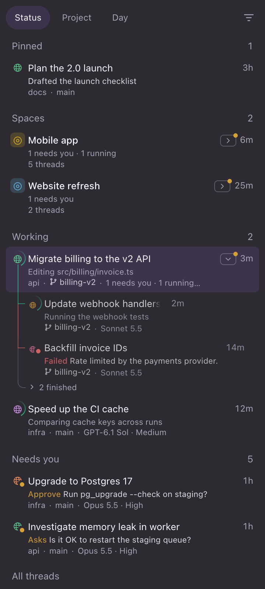
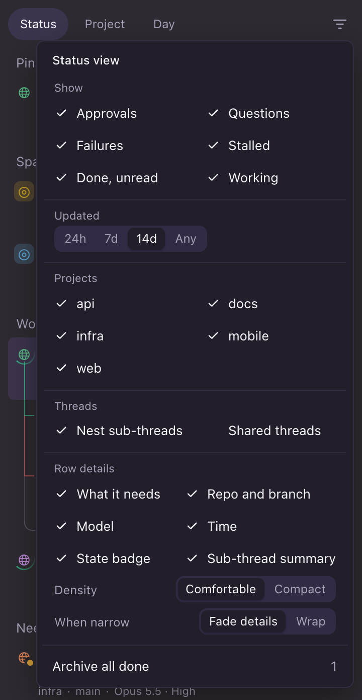
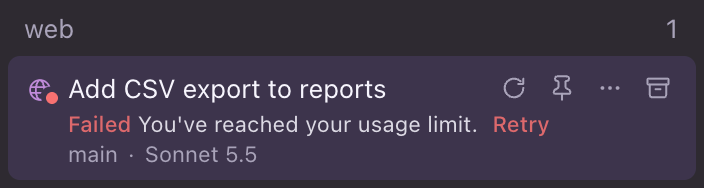

# Focus sidebar

Swaps Amp's thread list for just the threads that need you and the ones still working.

| Amp's list | Focus sidebar |
| --- | --- |
|  |  |

Threads are grouped by Status, Project or Day, with a filter menu at the top right for what each view shows. Pinned threads (Amp's own pins) stay at the top of Status even when idle, and Amp's search shows its matches in the same rows. Sub-threads and Spaces nest under their parent, and a family's finished threads sit under "N finished".

| Grouped by project | Filters |
| --- | --- |
|  |  |

- Hover a row for pin, archive and Amp's own menu (plus Mark done on an Ask, which hides it until the thread changes, and Retry on a failure), or swipe left with two fingers (a full swipe archives). Swipe right to snooze until something changes.

  

- Right-click or long-press opens Amp's menu for that thread.
- ⌃⌘A archives the open thread and moves to the next one. ⌘Z undoes.
- Arrow keys move between rows, → and ← open and close families, Enter opens, E archives, S snoozes, D marks an Ask done, P pins.

Archiving a parent archives its sub-threads too, and Undo puts back exactly what was archived. Archive uses the `amp` CLI, so install that too if you haven't ([ampcode.com/install](https://ampcode.com/install)).

Turn it off with `amp-tweaks tweaks disable focus-sidebar`.

## Working on it

`_demo/` runs this tweak against a stand-in for Amp's sidebar with made-up threads, so you can try a change without the live app. Serve this folder (`python3 -m http.server`) and open `/_demo/` (`?tweak=off` for Amp's own list, `?mode=project` or `?mode=day`). `node _demo/shoot.mjs [name…]` re-renders the screenshots above.
