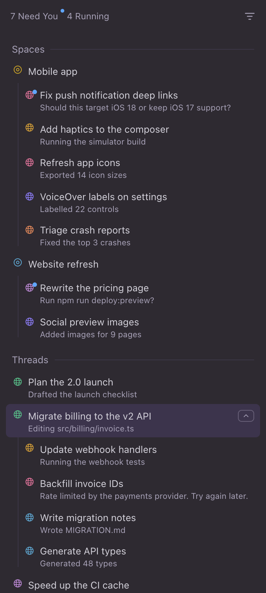
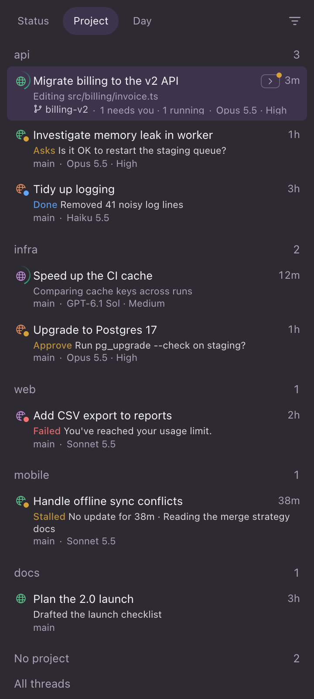

# Focus sidebar

Swaps Amp's thread list for just the threads that need you and the ones still working.

| Amp's list | Focus sidebar |
| --- | --- |
|  |  |

Threads are grouped by Status, Project or Day, with a filter menu at the top right for what each view shows. Pinned threads (Amp's own pins) stay at the top of Status even when idle, and Amp's search shows its matches in the same rows. Sub-threads and Spaces nest under the thread that started them (from Amp's own lineage, so a sub-thread of a sub-thread keeps its place even where Amp's list flattens it), and a family's finished threads sit under "N finished". A sub-thread with sub-threads of its own gets an "N sub-threads" fold under it (→ and ← work on the row too); folded, it says how many of them need you.

| Grouped by project | Filters |
| --- | --- |
|  |  |

- Hover a row for pin, archive and Amp's own menu (plus Mark done on an Ask or a finished thread, and Retry on a failure). The buttons slide out from behind a family's sub-thread button, which stays where it is. Or swipe left with two fingers (a full swipe archives). Swipe right to snooze.
- Snooze is Amp's own "Snooze Until I'm Needed": Amp brings the thread back when it has a new message or needs an approval, and your other devices agree. Mark done marks a finished thread read in Amp. Amp can't snooze a thread that's waiting on your answer, so S or Mark done on one hides it on this Mac until the thread changes.
- A thread whose runner has gone offline, or whose messages didn't send, shows under Needs you.

  

- Right-click or long-press opens Amp's menu for that thread.
- Resting on a row (or arrowing to it) loads that thread in the background, as Amp's own sidebar does, so it opens without waiting on Amp's server.
- ⌃⌘A archives the open thread and moves to the next one. ⌘Z undoes.
- Arrow keys move between rows, → and ← open and close families, Enter opens, E archives, S snoozes, D marks an Ask or a finished thread done, P pins.

While it's on, it turns off Amp's own sidebar filters (time range, hide running, needs-you only), since they'd hide threads from it. A project or automation filter set in Amp still applies; clear it from Amp's filter menu with the sidebar off.

Archiving a parent archives its sub-threads too, and Undo puts back exactly what was archived. Archive uses the `amp` CLI, so install that too if you haven't ([ampcode.com/install](https://ampcode.com/install)).

Turn it off with `amp-tweaks tweaks disable focus-sidebar`.

## Working on it

`_demo/` runs this tweak against a stand-in for Amp's sidebar with made-up threads, so you can try a change without the live app. Serve this folder (`python3 -m http.server`) and open `/_demo/` (`?tweak=off` for Amp's own list, `?mode=project` or `?mode=day`). `node _demo/shoot.mjs [name…]` re-renders the screenshots above.
